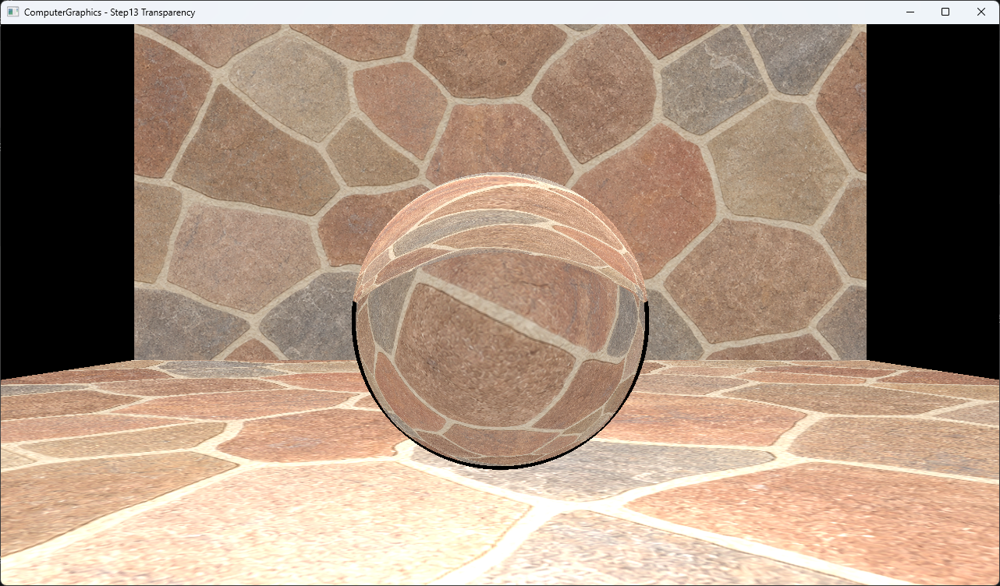
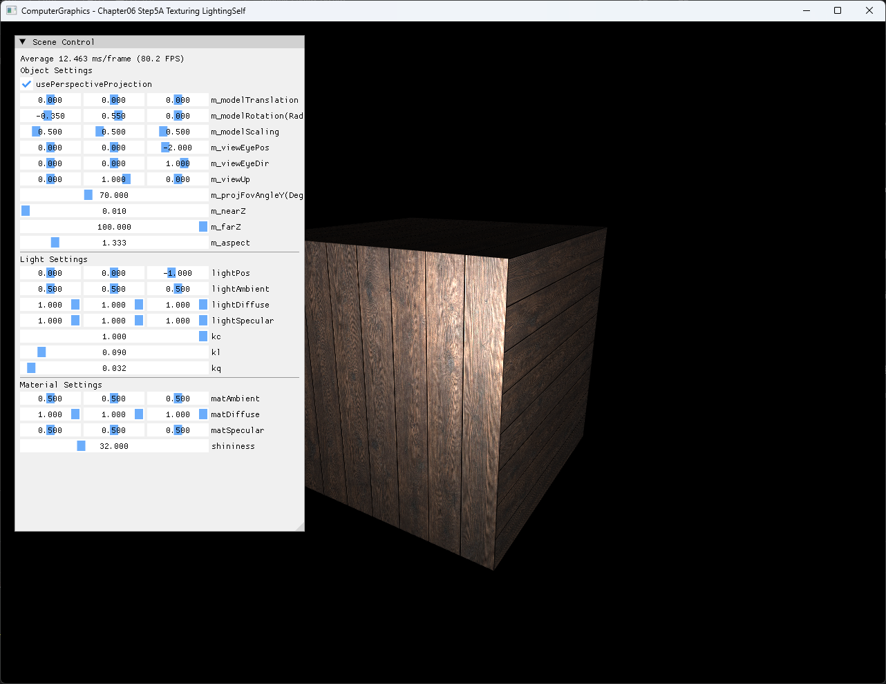
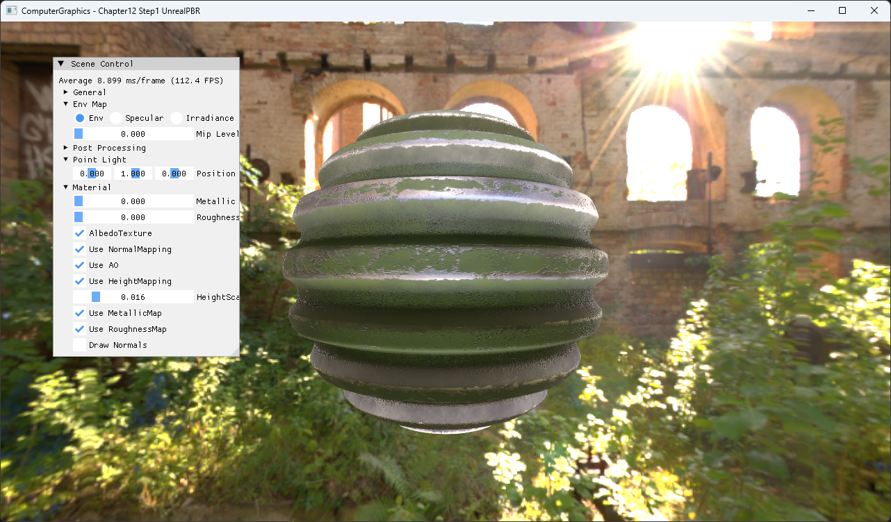
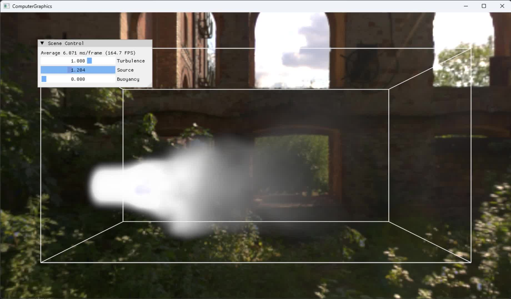

# Graphics Study Archive

교재·강의 기반 그래픽스 예제를 학습·구현하고, 원리·코드·실행 결과를 연결한 아카이브입니다. 일부 개인 확장 구현을 포함하며, 코드 주석과 옵시디언에 분산된 기록의 문서화·실행·촬영·형식 검사를 Codex로 정리하고 자동화합니다.

[프로젝트 안내](https://razria93.github.io/site/graphics.html) · [프로젝트 PDF · 25쪽](https://razria93.github.io/files/pdf/graphics-review.pdf) · [학습 영상](https://razria93.github.io/site/details/Graphics_Study_Archive/portfolio-demos/index.html) · [로컬 실행](#local-run)

<a id="학습-예제-실행-영상"></a>

## 대표 화면·시연

각 파트에서 하나씩 고른 기존 실행 화면입니다. 이미지나 주제명을 누르면 아래의 해당 구현 설명으로 이동합니다. 상세 실행 결과와 검증 조건은 각 설명의 Demo 링크에서 확인할 수 있습니다.

<table>
<tbody>
<tr>
<th width="50%"><a href="#learning-part1">Part 1 · CPU 반사·굴절</a></th>
<th width="50%"><a href="#learning-part2">Part 2 · DirectX11 텍스처·조명</a></th>
</tr>
<tr>
<td align="center" valign="middle"><a href="#learning-part1"></a></td>
<td align="center" valign="middle"><a href="#learning-part2"></a></td>
</tr>
<tr>
<td valign="top">반사·굴절 광선을 추적해 유리 구체 너머의 배경을 표현합니다.</td>
<td valign="top">텍스처·법선·광원을 연결해 상자의 면별 밝기를 표현합니다.</td>
</tr>
<tr>
<th width="50%"><a href="#learning-part3">Part 3 · PBR 재질·환경광</a></th>
<th width="50%"><a href="#learning-part4">Part 4 · GPU 연기 시뮬레이션</a></th>
</tr>
<tr>
<td align="center" valign="middle"><a href="#learning-part3"></a></td>
<td align="center" valign="middle"><a href="#learning-part4"></a></td>
</tr>
<tr>
<td valign="top">재질 맵과 환경광을 결합해 표면 질감과 반사를 표현합니다.</td>
<td valign="top">GPU로 갱신한 밀도장을 볼륨 렌더링합니다. 기존 시연의 한 프레임입니다.</td>
</tr>
</tbody>
</table>

교재·강의 기반 학습 예제의 기존 실행 기록입니다. 독자 설계나 통제된 성능 측정 결과를 뜻하지 않습니다.

[전체 예제 104개 · 실행 결과와 구현 설명](Docs/00_Index/examples.md)

[그래픽스 학습·구현](#learning) · [자동화·문제 해결](#automation)

<a id="프로젝트-개요작업-범위"></a>

## 프로젝트 개요

| 항목 | 내용 |
| --- | --- |
| 성격 | 교재·강의 기반 학습 프로젝트 · 일부 개인 확장 구현 |
| 기간 | 학습 2025.07–11 · 아카이브 정리 2026.07 이후 |
| 기술 | C++ · HLSL · DirectX11 |
| 범위 | 렌더링 파이프라인·재질·후처리·입력·애니메이션·GPU 연산 |
| 도구 | Codex · Windows API · FFmpeg |

## 작업 범위·기여

- **본인 작업:** 그래픽스 예제를 학습·구현하고, 문서·촬영 규격과 조건을 제시했습니다. 대표 산출물과 실행 결과를 검토하며 오류 대응 방향을 보완했습니다.
- **Codex 작업:** 코드·학습 기록 조사, 문서화와 촬영 도구 구현, 반복 실행·촬영·검사를 수행했습니다. 별도 재현 사본의 수정·추가 검증은 당시 작업과 구분합니다.

<a id="learning"></a>

## 대표 학습·구현

<a id="learning-part1"></a>

### Part 1 · CPU 반사·굴절

CPU에서 반사·굴절 광선을 재귀적으로 추적해 유리 구체 너머의 배경 왜곡을 표현합니다. 공기와 유리의 경계를 드나들 때 굴절 방향을 계산하고, 굴절할 수 없는 경우 반사 경로로 처리합니다.

공기와 굴절률 1.5를 사용하는 예제이며 중첩 매질·분산 등은 포함하지 않습니다. 앞선 반사 예제와 장면 구성도 달라, 투명도 하나만 바꾼 통제 비교는 아닙니다.

[요약 · PDF 13쪽](https://razria93.github.io/files/pdf/graphics-review.pdf#page=13) · [실행 결과·구현 과정 · Demo](Docs/03_Demos/Part1_Chapter03/03_13_Transparency.md)

<a id="learning-part2"></a>
<a id="directx11-데이터셰이더-연결"></a>

### Part 2 · DirectX11 텍스처·조명

텍스처·법선·광원 정보를 셰이더로 전달해 상자의 면별 밝기와 하이라이트를 표현합니다.


정점·인덱스·텍스처·상수 버퍼를 연결하고 `DrawIndexed`로 출력합니다. 실제 바인딩 코드와 결과를 설명하며, 개별 입력 효과를 분리한 비교 실험은 아닙니다.

[요약 · PDF 15쪽](https://razria93.github.io/files/pdf/graphics-review.pdf#page=15) · [실행 결과·구현 과정 · Demo](Docs/03_Demos/Part2_Chapter05-08/06_TexturingLightingSelf.md)

<a id="learning-part3"></a>

### Part 3 · PBR 재질·환경광

금속성·거칠기 등의 재질 맵과 환경광을 결합해 표면 질감과 반사를 표현합니다. 직접광의 BRDF와 IBL을 함께 계산하고, HDR 결과를 후처리해 화면에 표시합니다.

Clear coat·anisotropy·layered material은 포함하지 않습니다. 기존 학습 예제의 구현·실행 기록이며, 원본 재질 텍스처와 HDRI를 공개하는 자료는 아닙니다.

[요약 · PDF 19쪽](https://razria93.github.io/files/pdf/graphics-review.pdf#page=19) · [실행 결과·구현 과정 · Demo](Docs/03_Demos/Part3_Chapter10-13/12_01_UnrealPBR.md)

<a id="learning-part4"></a>

### Part 4 · GPU 연기 시뮬레이션

Compute Shader로 3차원 속도장·밀도장을 갱신하고, 밀도 텍스처를 볼륨 레이 마칭으로 표시합니다. 연기 발생과 이송·부력 처리에서 화면 출력까지 이어지는 흐름을 설명합니다.

대표 화면은 기존 시연의 한 프레임으로 연속 동작 전체를 대신하지 않습니다. 유한한 레이 마칭 단계와 밀도·조명 설정에 따라 시각 결과가 달라지며, 통제된 성능 측정 결과를 뜻하지 않습니다.

[요약 · PDF 24쪽](https://razria93.github.io/files/pdf/graphics-review.pdf#page=24) · [실행 결과·구현 과정 · Demo](Docs/03_Demos/Part4_Chapter14-20/16_04_RealtimeSmoke.md)

### 전체 학습 범위

| 파트 | 주요 학습 내용 | 코드·예제 설명 |
| --- | --- | --- |
| Part 1 | DirectX11 기초, 이미지 후처리, CPU Ray Tracing | [Chapter 01–02](Part1_Chapter01-02/README.md) · [Chapter 03](Part1_Chapter03/README.md) |
| Part 2 | 래스터화·UV 보간, 변환·조명, 메시 구성과 렌더링 파이프라인 | [Chapter 04](Part2_Chapter04/README.md) · [Chapter 05–08](Part2_Chapter05-08/README.md) |
| Part 3 | 선택·조작, Tessellation, Mapping, PBR·IBL, HDR·그림자 | [Chapter 09](Part3_Chapter09/README.md) · [Chapter 10–13](Part3_Chapter10-13/README.md) |
| Part 4 | Compute Shader, 입자·유체, 스켈레탈 애니메이션, 인스턴싱 | [Chapter 14–20](Part4_Chapter14-20/README.md) |

상단의 전체 예제 목록 104개에서 예제별 **실행 결과·Demo → 구현·실행 설명**으로 이동할 수 있습니다. 상세 문서의 상단·하단에서 전체 예제 목록이나 README로 돌아옵니다. Demo는 103개이며 DirectX11 초기화 예제 1개는 별도 Demo 없이 예제 README로 안내합니다.

[문서 전체 안내](Docs/00_Index/README.md) · [개념 문서](Docs/00_Index/topic-map.md) · [검증 기록](Docs/02_Verification/README.md) · [알려진 이슈](Docs/02_Verification/known-issues.md)


<a id="automation"></a>

## AI로 반복 작업을 확장한 과정

학습 결과를 설명할 수 있는 자료로 정리하기 위해, 예제마다 반복되는 작업에 공통 규격과 순서를 적용했습니다. 대표 예제로 규격을 검토한 뒤 Codex의 작업 범위를 문서 정리·실행·촬영·형식 검사로 넓혔습니다.

### 작업 기준을 정하고 대표 예제로 검토

본인은 문서·실행 결과 규격과 촬영 방법·조건·제한사항을 제시하고, 대표 예제 결과를 검토해 보완 의견을 전달했습니다. Codex는 코드·학습 기록을 조사해 문서를 작성하고, 예제 설명·검증 기록·Demo를 연결하며 작업 절차를 보완했습니다.

[대표 예제 검토 기록](Docs/04_WorkLogs/reviews/Part1_Chapter01-02.md) · [협업 환경·작업 범위](Docs/04_WorkLogs/reviews/part1-pilot-collaboration-environment.md) · [공통 README 규격](Docs/98_Tools/templates/example-readme.md)

### 반복 실행·촬영을 공통 도구로 확대

본인은 진행을 관찰하고 예외 발생 시 맥락과 해결 방향을 조정했습니다. Codex는 Windows API·FFmpeg 기반 촬영 도구를 구현하고 후속 예제의 정리·실행·촬영·형식 검사를 수행했습니다. 공통 도구의 창·실행·촬영 처리와 예제별 입력·매개변수 조작을 구분해 반복 작업에 적용했습니다.

[촬영 운영 절차](Docs/98_Tools/capture-operation-guide.md) · [창 촬영 도구와 예제별 조작](Docs/98_Tools/example-window-recording.md)

### 검토 결과를 보완과 회귀 검사로 연결

본인은 학습 내용·정리 목적과 자료의 대응을 확인했습니다. Codex는 보완 의견에 따라 자료와 문서·링크를 수정하고, 발견된 링크·촬영 범위·입력 처리 문제를 검토 기록과 반복 검사로 남겼습니다.

[검토·보완 기록](Docs/04_WorkLogs/reviews/review-feedback-log.md) · [검사 도구와 범위](Docs/98_Tools/validation-tools.md) · [문서 검사 워크플로](.github/workflows/docs-validation.yml)

자동 검사는 문서 형식·링크·도구 규칙의 확인을 돕습니다. 실제 그래픽스 구현과 화면 의미의 검토를 대신하지 않으며, 생산성·시간 절약을 정량 측정한 결과는 아닙니다.

## 문제 해결

| 사례 | 핵심 결과 | 자료 | 영상 |
| --- | --- | --- | --- |
| 자동 촬영 도구<br>오류 창 정리 | 이전 오류 창과 새 실행 결과의 혼재에 대응.<br>오류 창 정리 완료와 실패 감지를 구분 | [PDF 6–8쪽](https://razria93.github.io/files/pdf/graphics-review.pdf#page=6)<br>[조건·한계](#자동-촬영-도구) | [오류 창 정리<br>재현 영상](https://razria93.github.io/site/details/Graphics_Study_Archive/portfolio-evidence/capture/index.html#video) |
| Assimp<br>구조 호환 | Pivot 보조 노드·채널 구조를 로더 처리 방식에 맞춤.<br>동일 자산·Assimp 버전에서 옵션 전후 비교 | [PDF 9–11쪽](https://razria93.github.io/files/pdf/graphics-review.pdf#page=9)<br>[조건·한계](#assimp-구조-호환) | [보행 비교<br>영상](https://razria93.github.io/site/details/Graphics_Study_Archive/portfolio-evidence/assimp/index.html#comparison-video) |

- **촬영 도구:** 실패 감지는 오류 창 정리 성공과 다릅니다. 실제 DLL 복구·Clean/Rebuild·원래 촬영 재개까지 확인한 결과는 아닙니다.
- **Assimp:** 초기 자세 보완은 별도 재현 사본 양쪽에 동일하게 적용했으며 원본 미반영입니다. 실제 재생 비교는 보행 클립에 한정합니다.

## 검증 조건·한계

<a id="01--자동-촬영-도구--오류-창-정리-완료를-판별하도록-보완"></a>

### 자동 촬영 도구

오류 창 A를 닫은 뒤 나타난 B가 남아, 이전 오류와 새 실행 결과가 혼재하고 Codex의 대응이 반복되는 문제가 있었습니다. 사용자는 일정 간격으로 재확인하고, 오류 창이 없음을 확인한 뒤 다음 작업을 진행하도록 제안했습니다. Codex는 오류 창 정리와 결과 판별 코드를 보완했습니다.

- **자료 성격:** 공개 영상은 현상과 대응 절차를 설명하는 재현 시연입니다.
- **검증 방법:** 테스트 창 5개 조건을 각 3회 확인했습니다. 이번 재검증은 테스트 창을 이용한 정리 코드의 정상·실패 조건 확인입니다.
- **결과 해석:** 실패 감지 조건의 충족은 오류 창 정리 성공을 의미하지 않습니다. 지연 오류는 감지 후 실패 종료하고 자동 재정리하지 않습니다.
- **별도 회귀 테스트:** 완료 대기 한도 5초의 원본이 실패하고 한도만 15초로 늘린 사본이 통과했으나, 실패 원인은 확정하지 못했습니다.
- **확인하지 않은 범위:** 실제 DLL 복구·Clean/Rebuild·원래 촬영 재개를 검증한 결과로 표현하지 않습니다.

[테스트 결과·한계](https://razria93.github.io/site/details/Graphics_Study_Archive/portfolio-evidence/capture/index.html#results)

<a id="02--assimp--임포트-구조를-로더의-처리-방식에-맞춤"></a>

### Assimp 구조 호환

Pivot 보존으로 생성되는 보조 노드와 애니메이션 채널 구조가 기존 로더의 처리 방식과 맞지 않아 캐릭터 형태가 무너지는 사례입니다. 동일한 자산과 Assimp 버전에서 옵션 적용 전후의 구조와 보행 결과를 비교합니다.

- **당시 확인:** 당시 수정 결과는 본인이 직접 실행해 확인했습니다.
- **이번 비교 조건:** 별도 재현 사본에서 Codex가 초기 자세 보완을 양쪽에 동일하게 적용하고 Pivot 옵션을 바꿔 수행했습니다.
- **원본 반영 여부:** 초기 자세 보완은 원본에 반영하지 않았습니다.
- **확인 범위:** 구조 검사는 5개 클립·실제 재생 비교는 보행 클립에 한정합니다.
- **미검증 범위:** 다른 클립 전체 재생·장시간 실행·임의 자산은 미검증입니다.

[구조 검사 결과](https://razria93.github.io/site/details/Graphics_Study_Archive/portfolio-evidence/assimp/index.html#case-3) · [당시 기록과 이번 작업 구분](https://razria93.github.io/site/details/Graphics_Study_Archive/portfolio-evidence/assimp/index.html#case-4)

## 관련 자료

<details>
<summary>추가 학습 사례 · GPU Blur 리소스 교대</summary>

### GPU Blur 리소스 교대

X 패스는 A 읽기·B 쓰기, Y 패스는 B 읽기·A 쓰기로 SRV/UAV를 교대합니다. 바인딩 해제는 GPU 완료 대기가 아니며 성능 비교를 제시하지 않습니다.

[리소스 교대 · PDF 23쪽](https://razria93.github.io/files/pdf/graphics-review.pdf#page=23) · [실행 결과·구현 흐름](Docs/03_Demos/Part4_Chapter14-20/14_02_Blur.md)

</details>

- [통합 PDF · 그래픽스 39–62쪽](https://razria93.github.io/files/pdf/combined-review.pdf#page=39)
- [주제별 포트폴리오](PORTFOLIO.md): 학습·구현 사례와 문서 안내
- [이전 제출 PDF · 2026-10-22 v5](https://razria93.github.io/Graphics_Study_Archive/portfolio/files/graphics-portfolio-20261022-v5.pdf): 보존본. [버전 안내](PORTFOLIO.md#version)에서 현재 안내와 구분합니다.

<details>
<summary>학습 영상 · 연기와 잔디</summary>

| 영상 | 길이 | 확인할 내용 |
| --- | --- | --- |
| [연기 시뮬레이션](https://razria93.github.io/site/details/Graphics_Study_Archive/portfolio-demos/index.html#realtime-smoke) | 약 27초 | Scene Control 조작에 따른 연기 흐름과 확산 |
| [잔디 렌더링](https://razria93.github.io/site/details/Graphics_Study_Archive/portfolio-demos/index.html#grass) | 약 8초 | 다수 잔디의 시간에 따른 흔들림 |

</details>

<a id="예제-실행-시작하기"></a>
<a id="quickstart"></a>
<a id="local-run"></a>

## 로컬 실행

### 저장소·환경 준비

기본 환경은 Windows, Visual Studio 2022의 C++ 데스크톱 개발 도구(v143), Windows SDK 10.x입니다. 예제별 추가 라이브러리와 실행 조건은 해당 폴더의 README와 검증 기록을 확인합니다.

```bash
git clone https://github.com/Razria93/Graphics_Study_Archive.git
```

### 예제 실행

1. [01_DX11InitAndImGui](Part1_Chapter01-02/01_DX11InitAndImGui/README.md)의 `01_DX11InitAndImGui.sln`을 Visual Studio에서 엽니다.
2. 시작 프로젝트를 `01_DX11InitAndImGui`, 구성을 `Debug | x64`로 설정하고 빌드·실행합니다.
3. 셰이더 파일을 찾지 못하면 실행 작업 디렉터리가 해당 예제 폴더인지 확인합니다.

### 실행 후 확인

예제별 입력·결과·확인 조건은 상단의 전체 예제 목록에서 해당 Demo와 구현·실행 설명을 열어 확인합니다.

[빌드·실행 기준](BUILD.md) · [기존 Debug/Release 검증 기록](Docs/02_Verification/Part1_Chapter01-02/verification-index.md) · [알려진 이슈](Docs/02_Verification/known-issues.md)

실행 상태는 연결한 검증 기록의 환경과 범위를 기준으로 확인합니다.

## 저장소 구조

| 경로 | 역할 |
| --- | --- |
| [Part1_Chapter01-02](Part1_Chapter01-02/README.md)<br>[Part1_Chapter03](Part1_Chapter03/README.md) | DirectX11 기초·CPU Ray Tracing 예제 |
| [Part2_Chapter04](Part2_Chapter04/README.md)<br>[Part2_Chapter05-08](Part2_Chapter05-08/README.md) | 래스터화·변환·조명·렌더링 파이프라인 예제 |
| [Part3_Chapter09](Part3_Chapter09/README.md)<br>[Part3_Chapter10-13](Part3_Chapter10-13/README.md) | 조작·재질·HDR·그림자 예제 |
| [Part4_Chapter14-20](Part4_Chapter14-20/README.md) | GPU 연산·시뮬레이션·애니메이션 예제 |
| [Docs/00_Index](Docs/00_Index/README.md) | 전체 예제·개념·실행 결과·검증의 진입점 |
| [Docs/03_Demos](Docs/03_Demos/) | 실행 화면·입력·구현 흐름·결과 해석 |
| [Docs/02_Verification](Docs/02_Verification/) | 빌드·실행 검증과 알려진 한계 |
| [Docs/04_WorkLogs](Docs/04_WorkLogs/README.md) | 학습 자료 정리·협업·검토 기록 |
| [Docs/98_Tools](Docs/98_Tools/README.md) | 촬영·문서 검사 도구와 운영 안내 |
| [PORTFOLIO.md](PORTFOLIO.md) · [NOTICE.md](NOTICE.md) | 선정 사례와 출처·작업 범위 |

## 학습 출처와 작업 범위

교재·강의 기반 예제를 학습하며 구현·실행한 코드와 일부 개인 확장을 포함합니다. 모든 기능을 독자 설계한 프로젝트로 주장하지 않으며, 개별 예제의 출처와 확장 범위는 각 README와 [NOTICE](NOTICE.md)를 따릅니다. 이후 Codex를 활용한 조사·문서화·촬영·재검증은 기존 학습 구현과 구분합니다.

**Bloom 예제의 입력 이미지 출처**

Bloom 예제는 ChatGPT 생성 입력 이미지에 후처리를 적용한 결과이며 직접 제작한 3D 장면이 아닙니다. [입력·처리 과정·결과](Docs/03_Demos/Part1_Chapter01-02/02_Bloom.md)와 출처 설명은 해당 사례에서 확인할 수 있습니다.

포트폴리오는 선정한 경험을 요약하고, 예제 README·개념 문서·검증 기록·Demo가 세부 근거를 제공합니다. [포트폴리오 안내와 버전 기준](PORTFOLIO.md#version)에서 공개 PDF의 기준일과 갱신 방식을 확인할 수 있습니다.

<details>
<summary>문서 구조와 관리 안내</summary>

- [문서 전체 진입점](Docs/00_Index/README.md): 학습·개념·검증·Demo 지도
- [작업 기록](Docs/04_WorkLogs/README.md): 정리 과정과 검토 내역
- [공개 정책](Docs/06_Policies/publication-policy.md): 자료 공개 범위
- [문서 관리 도구](Docs/98_Tools/README.md): 규격·검사·작업 절차
- [저장소 작업 지침](AGENTS.md): 변경과 검증 기준

</details>
